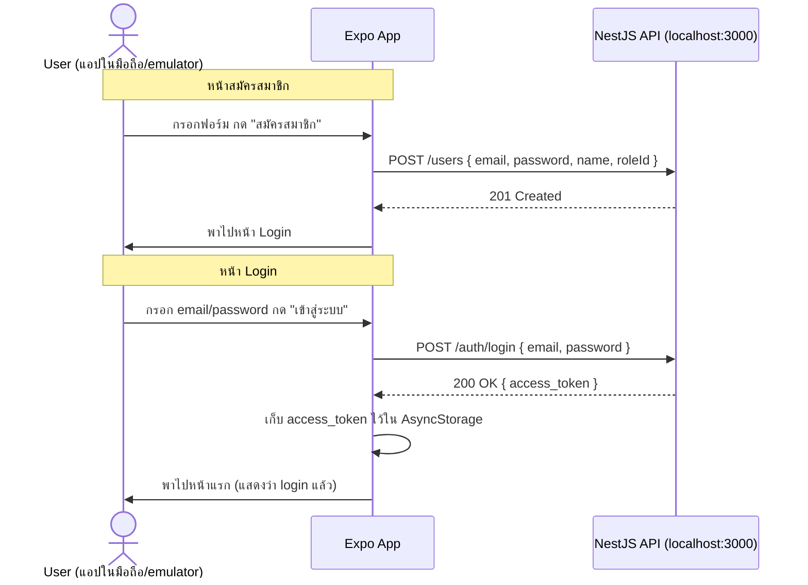

# คู่มือสร้าง Mobile App (React Native + Expo) หน้า Login + สมัครสมาชิก แบบ Step-by-Step

เอกสารนี้สอนสร้าง **Mobile App ด้วย React Native (Expo)** — concept และหน้าจอเดียวกับ `FRONTEND_GUIDE.md` (Login + สมัครสมาชิก) แต่เขียนสำหรับแอปมือถือแทนเว็บ เชื่อมกับ backend (`apps/api`) ตัวเดียวกัน — ทุกคำสั่ง/โค้ดในนี้ติดตั้งและทดสอบผ่านจริงแล้วใน `mobile/apps` ก่อนเขียนคู่มือ

## โฟลเดอร์ไหนทำอะไร

| โฟลเดอร์ | สถานะ | ใช้ทำอะไร |
|---|---|---|
| **`mobile/apps`** | ทำหน้า Login + สมัครสมาชิกเสร็จแล้ว เชื่อม `apps/api` จริง | **เฉลย/ของจริงที่ใช้งาน** — เทียบผลลัพธ์/โค้ดได้เลย |
| **`mobile/ex`** | scaffold เปล่าๆ (แค่ `create-expo-app` default) | **ที่ฝึกของนักเรียน** — ทำตามคู่มือนี้สร้างทุกไฟล์เอง |

> คู่มือนี้ต้องมี backend (`apps/api`) รันอยู่แล้วและทำ `AUTH_GUIDE.md` เสร็จแล้ว (มี `POST /auth/login` และ `POST /users` ที่ `@Public()`) — ถ้ายังไม่ได้ทำ ให้ไปทำ `AUTH_GUIDE.md` ก่อน แนะนำให้อ่าน `FRONTEND_GUIDE.md` ผ่านๆ ก่อนด้วย เพราะ logic การเรียก API เหมือนกันทุกอย่าง ต่างแค่วิธีเขียน UI

---

## 0. Expo คืออะไร มีหน้าที่หลักๆ อะไรบ้าง

**React Native** คือ framework สำหรับเขียนแอปมือถือด้วย JavaScript/TypeScript (ได้แอป native จริง ไม่ใช่เว็บที่ห่อเป็นแอป) แต่การตั้งค่าโปรเจค React Native แบบเปล่าๆ (bare) ต้องยุ่งกับ Android Studio/Xcode และ native code ตั้งแต่วันแรก — **Expo คือชั้นเครื่องมือที่ครอบ React Native อีกที** ทำให้เริ่มต้นและพัฒนาได้ง่ายขึ้นมาก มีหน้าที่หลักๆ 4 อย่าง:

1. **เครื่องมือรัน/ทดสอบแอประหว่างพัฒนา (Expo Go + Dev Server)** — ปกติแอป React Native ต้อง build เป็นแอปจริง (`.apk`/`.ipa`) ก่อนถึงจะรันบนมือถือได้ Expo ทำให้**ข้ามขั้นตอน build ได้ระหว่างพัฒนา** แค่รัน `npx expo start` แล้วสแกน QR ด้วยแอป **Expo Go** (ตัวกลางที่โหลดจาก store มาลงไว้ล่วงหน้า) ก็เห็นผลทันที แก้โค้ดแล้ว reload สดๆ ให้เลย (hot reload) — นี่คือสิ่งที่ใช้อยู่ตลอดคู่มือนี้ (หัวข้อ 12)
2. **ห่อ native API ที่ยุ่งยากให้เรียกง่ายขึ้น (Expo SDK)** — ฟีเจอร์ที่ปกติต้องเขียนโค้ด native แยก Android/iOS เอง (กล้อง, GPS, local storage ฯลฯ) Expo ทำเป็น JavaScript library เรียกใช้ได้ข้าม platform ด้วยโค้ดชุดเดียว เช่น `@react-native-async-storage/async-storage` ที่ใช้ในหัวข้อ 6
3. **CLI จัดการโปรเจค (Expo CLI)** — คำสั่งที่ใช้ตลอดคู่มือนี้ (`create-expo-app`, `expo install`, `expo start`) คือตัวนี้ จัดการ scaffold โปรเจค, bundle โค้ด (ผ่าน Metro), รัน dev server ให้
4. **บริการ build/deploy แอปจริงตอนจบงาน (EAS — Expo Application Services)** — พอพัฒนาเสร็จแล้วอยากได้ไฟล์ `.apk`/`.ipa` จริงไปลง store Expo มีบริการ build บน cloud ให้ (`eas build`) โดยไม่ต้องมี Android Studio/Xcode เองก็ได้ — **ยังไม่ได้สอนส่วนนี้ในคู่มือ** (ดูหัวข้อ 14 "ขั้นต่อไป")

---

## 0.1 Mobile ต่างจาก Web (Next.js) ตรงไหนบ้าง



**สิ่งที่เหมือนกับ `FRONTEND_GUIDE.md` ทุกประการ:** logic การเรียก API (`fetch`, error handling, การเก็บ token ไว้ใช้ต่อ) — ฟังก์ชัน `login()`/`createUser()` ใน `lib/api.ts` **โค้ดเหมือนกันตัวต่อตัว** กับฝั่งเว็บเลย เพราะ `fetch()` เป็น Web API มาตรฐานที่ React Native มีให้ใช้ในตัวเหมือนกัน (ไม่ต้องติดตั้ง library เสริม)

**สิ่งที่ต่างจาก `FRONTEND_GUIDE.md`:**

| เรื่อง | Web (Next.js) | Mobile (React Native) |
|---|---|---|
| UI element | `<input>`, `<button>`, `<div>` (HTML) | `<TextInput>`, `<Pressable>`, `<View>` (component ของ React Native เอง ไม่ใช่ HTML) |
| จัดสไตล์ | Tailwind CSS (`className="..."`) | `StyleSheet.create({...})` (object ธรรมดา ไม่มี CSS syntax) |
| เก็บ token | `localStorage` (มีอยู่ในเบราว์เซอร์) | `AsyncStorage` (ต้องติดตั้ง library เพิ่ม — เบราว์เซอร์เท่านั้นที่มี `localStorage` ในตัว) |
| เปลี่ยนหน้า | Next.js file-based routing (โฟลเดอร์ = URL) | React Navigation (ประกาศ "หน้าจอ" ในโค้ดเอง ไม่มีระบบ URL) |
| Environment variable | ต้องขึ้นต้น `NEXT_PUBLIC_` ถึงจะใช้ฝั่ง client ได้ | ต้องขึ้นต้น `EXPO_PUBLIC_` แทน (คนละ prefix แต่หลักการเดียวกัน) |
| ทดสอบ | เปิดเบราว์เซอร์เข้า `localhost` ตรงๆ ได้เลย | ต้องรันผ่าน emulator/มือถือจริง + เรื่อง network address ซับซ้อนกว่า (ดูหัวข้อ 3) |

---

## 1. สร้างโปรเจค Expo

```bash
cd mobile
npx create-expo-app@latest apps --template blank-typescript
```

ระหว่างรันจะถามว่า `"You are creating a project inside of an existing Git repository. Skip initializing a new git repository?"` — **ตอบ `Y` (หรือกด Enter)** เพราะ repo นี้มี git อยู่แล้วที่ root ไม่ต้องการให้ Expo สร้าง git ซ้อนอีกชุดข้างในโฟลเดอร์ย่อย

> **ถ้าทำตามคู่มือนี้ในโฟลเดอร์ `mobile/ex` (ที่ฝึกของนักเรียน): ข้ามขั้นตอนนี้ไปเลย** เพราะ `mobile/ex` มี scaffold เปล่าๆ เตรียมไว้ให้แล้ว (สร้างล่วงหน้าด้วยคำสั่งเดียวกันนี้ แค่เปลี่ยนชื่อท้ายคำสั่งจาก `apps` เป็น `ex`) ให้เริ่มทำตามตั้งแต่หัวข้อ 2 เป็นต้นไปในโฟลเดอร์นั้นได้ทันที — **ห้ามรันคำสั่งนี้ซ้ำใส่โฟลเดอร์ที่มีไฟล์อยู่แล้ว** เพราะจะถูกปฏิเสธทันที (เหมือนที่อธิบายไว้ใน `FRONTEND_GUIDE.md` หัวข้อ 1.1)

**เช็คว่าไม่มีช่องโหว่ความปลอดภัยระดับสูงหลงเหลือ:**
```bash
npm audit
```
ตอนเขียนคู่มือนี้ (ก่อนติดตั้ง `react-dom`/`react-native-web` ในหัวข้อ 2) จะเห็น **10 moderate severity vulnerabilities** ทั้งหมดมาจาก `xcode` package (ใช้ตอน generate โปรเจค iOS native เท่านั้น) ที่ซ่อนอยู่ลึกใน dependency chain ของ `@expo/cli` เอง — **เป็นปัญหาของทั้ง ecosystem Expo ในเวอร์ชันปัจจุบัน ยังไม่มี patch เสถียรจากทีม Expo** (เช็คแล้วตอนเขียนคู่มือนี้) เป็น dev-tooling เท่านั้น **ไม่ได้ติดไปกับแอปที่ build จริงส่งให้ผู้ใช้** จึงรับความเสี่ยงนี้ไว้ก่อนได้ ไม่ต้องพยายาม `npm audit fix --force` (จะพังเวอร์ชันที่ Expo pin ไว้ให้เข้ากันพอดี) — **พอติดตั้ง web support ในหัวข้อ 2 แล้วตัวเลขจะเพิ่มเป็น 23 ตัว (7 moderate, 16 high)** เพราะดึง dependency chain ของ Metro bundler (`metro`, `metro-config`, `braces`, `micromatch` ฯลฯ) เข้ามาเพิ่ม — ยังคงเป็น dev-tooling ล้วนๆ เหมือนเดิม (ตัวที่ใช้ compile/serve โค้ดตอน dev เท่านั้น ไม่ได้ติดไปกับแอปที่ build จริง) รับความเสี่ยงนี้ไว้ได้เหมือนกัน

---

## 2. ติดตั้ง Library เพิ่มเติม

```bash
npx expo install @react-navigation/native @react-navigation/native-stack react-native-screens react-native-safe-area-context
npx expo install @react-native-async-storage/async-storage
npx expo install react-dom react-native-web
```

| Package | ใช้ทำอะไร |
|---|---|
| `@react-navigation/native` | Library หลักสำหรับจัดการ "เปลี่ยนหน้าจอ" ใน React Native (ไม่มีระบบ URL แบบเว็บ ต้องประกาศเองว่ามีหน้าจอไหนบ้างและสลับกันอย่างไร) |
| `@react-navigation/native-stack` | รูปแบบการเปลี่ยนหน้าแบบ "ซ้อนสแตก" (เปิดหน้าใหม่ทับ, กด back ย้อนกลับ) เหมือน native app ทั่วไป |
| `react-native-screens`, `react-native-safe-area-context` | Dependency พื้นฐานที่ React Navigation ต้องใช้ (จัดการพื้นที่หน้าจอให้ไม่ชนกับ notch/status bar) |
| `@react-native-async-storage/async-storage` | ที่เก็บข้อมูลแบบถาวรบนมือถือ (เทียบเท่า `localStorage` ของเว็บ — ใช้เก็บ `access_token`) |
| `react-dom`, `react-native-web` | ให้โปรเจครันผ่าน `npm run web` ได้ (ดูหัวข้อ 12) — จำเป็นถ้าอยากทดสอบผ่านเบราว์เซอร์โดยไม่ต้องมี emulator/มือถือ ถ้าไม่ติดตั้งไว้ก่อน `npm run web` จะ error ทันทีว่าขาด dependency |

> **ทำไมใช้ `npx expo install` แทน `npm install` ธรรมดา:** `expo install` จะเลือกเวอร์ชันของแต่ละ package ให้ **ตรงกับ Expo SDK ที่โปรเจคใช้อยู่โดยอัตโนมัติ** (เช่น SDK 57 ต้องการ `react-native-screens` เวอร์ชันที่ตรงกันเป๊ะ) ถ้าใช้ `npm install` เฉยๆ อาจได้เวอร์ชันล่าสุดที่ไม่ compatible กับ SDK ปัจจุบัน แล้ว native module พังตอนรันจริง

---

## 3. โครงสร้างไฟล์ที่จะสร้างเพิ่ม

```
src/
├── lib/
│   ├── api.ts      # ฟังก์ชันเรียก backend (login, createUser) — โค้ดเดียวกับฝั่งเว็บ
│   ├── token.ts     # เก็บ/อ่าน/ลบ access_token ด้วย AsyncStorage (แทน localStorage)
│   └── roles.ts     # รายชื่อ role แบบ hardcode (เหมือนฝั่งเว็บ)
└── screens/
    ├── HomeScreen.tsx
    ├── LoginScreen.tsx
    └── RegisterScreen.tsx
App.tsx              # (แก้ของเดิม) ตั้งค่า React Navigation ผูกหน้าจอทั้งหมดเข้าด้วยกัน
```

---

## 4. ตั้งค่า API URL (`.env.local`) — และเรื่อง network ที่ต้องระวัง

สร้างไฟล์ `.env.local` ที่ root ของโปรเจค:
```env
EXPO_PUBLIC_API_URL="http://localhost:3000"
```

และ `.env.local.example` (commit ขึ้น git ได้ — ไฟล์นี้ **ไม่ถูก** `.gitignore` บล็อกอัตโนมัติอยู่แล้ว เพราะ pattern ของ Expo คือ `.env*.local` ซึ่งจับเฉพาะไฟล์ที่ **ลงท้าย** ด้วย `.local` เท่านั้น — `.env.local.example` ลงท้ายด้วย `.example` จึงไม่โดนบล็อก):
```env
EXPO_PUBLIC_API_URL="http://localhost:3000"
```

**ทำไมต้องมี prefix `EXPO_PUBLIC_`:** เหตุผลเดียวกับ `NEXT_PUBLIC_` ฝั่งเว็บ — Expo จะฝัง env variable เข้าไปในแอปจริงเฉพาะตัวที่ขึ้นต้นด้วย prefix นี้เท่านั้น (กันเผลอ leak ค่าลับที่ไม่ได้ตั้งใจให้ตัวแอปเห็น)

### ⚠️ `localhost` ใช้ไม่ได้เสมอไปบนมือถือ (จุดต่างสำคัญจากเว็บ)

ฝั่งเว็บ `localhost:3000` ใช้ได้เสมอเพราะเบราว์เซอร์รันอยู่บนเครื่องเดียวกับ backend แต่ **มือถือ/emulator เป็น "เครื่อง" คนละตัวกัน** (แม้จะรันอยู่บนคอมพิวเตอร์เดียวกันก็ตาม) `localhost` ในบริบทของมือถือ/emulator แปลว่า **"ตัวมันเอง"** ไม่ใช่เครื่อง PC ที่รัน backend อยู่ — ต้องตั้งค่าตามชนิดของอุปกรณ์ที่ทดสอบ:

| ทดสอบบน | ตั้ง `EXPO_PUBLIC_API_URL` เป็น |
|---|---|
| **Expo Go บนเว็บเบราว์เซอร์** (`npm run web`) | `http://localhost:3000` (ใช้ได้ปกติ เพราะรันในเบราว์เซอร์จริงๆ) |
| **Android Emulator** | `http://10.0.2.2:3000` (ค่าพิเศษที่ Android Emulator กำหนดไว้ให้แทน "PC ที่รัน emulator อยู่") |
| **iOS Simulator** (Mac เท่านั้น) | `http://localhost:3000` (iOS Simulator ใช้ network เดียวกับ Mac ได้ตรงๆ) |
| **มือถือจริงผ่านแอป Expo Go** | `http://<IP ของ PC ในวง LAN>:3000` (เช่น `http://192.168.1.10:3000`) — หาด้วย `ipconfig` (Windows) หรือ `ifconfig` (Mac/Linux) มือถือกับ PC ต้องต่อ **Wi-Fi วงเดียวกัน** |

**และอย่าลืม CORS:** ถ้าทดสอบผ่านเว็บ (`npm run web`) ต้องเปิด CORS ที่ backend เหมือนกับตอนทำ `FRONTEND_GUIDE.md` (`app.enableCors(...)` ใน `apps/api/src/main.ts`) — แต่ถ้าทดสอบผ่าน Android/iOS Emulator หรือมือถือจริง **ไม่ต้องกังวลเรื่อง CORS เลย** เพราะ CORS เป็นกฎที่บังคับใช้เฉพาะตอนรันในเบราว์เซอร์เท่านั้น แอป native ไม่ถูกบล็อกด้วยกฎนี้

---

## 5. สร้าง `lib/api.ts` — เหมือนฝั่งเว็บทุกบรรทัด

```typescript
// src/lib/api.ts
const API_URL = process.env.EXPO_PUBLIC_API_URL;

export class ApiError extends Error {
  constructor(
    message: string,
    public status: number,
  ) {
    super(message);
  }
}

async function parseErrorMessage(res: Response): Promise<string> {
  const body = await res.json().catch(() => null);
  if (!body?.message) return `Request failed with status ${res.status}`;
  return Array.isArray(body.message) ? body.message.join(', ') : body.message;
}

export type LoginPayload = {
  email: string;
  password: string;
};

export type LoginResponse = {
  access_token: string;
};

export async function login(payload: LoginPayload): Promise<LoginResponse> {
  const res = await fetch(`${API_URL}/auth/login`, {
    method: 'POST',
    headers: { 'Content-Type': 'application/json' },
    body: JSON.stringify(payload),
  });

  if (!res.ok) throw new ApiError(await parseErrorMessage(res), res.status);
  return res.json();
}

export type CreateUserPayload = {
  email: string;
  password: string;
  name: string;
  roleId: string;
};

export type User = {
  id: string;
  email: string;
  name: string;
  roleId: string;
  isActive: boolean;
  createdAt: string;
  updatedAt: string;
};

export async function createUser(payload: CreateUserPayload): Promise<User> {
  const res = await fetch(`${API_URL}/users`, {
    method: 'POST',
    headers: { 'Content-Type': 'application/json' },
    body: JSON.stringify(payload),
  });

  if (!res.ok) throw new ApiError(await parseErrorMessage(res), res.status);
  return res.json();
}
```

**ทำไมเหมือนฝั่งเว็บทุกบรรทัด:** `fetch()` เป็น **Web API มาตรฐาน** ที่ไม่ได้ผูกกับเบราว์เซอร์เท่านั้น — React Native (ทั้ง Expo และ bare RN) implement `fetch()` ให้ใช้งานได้เหมือนกันโดยไม่ต้องติดตั้ง library เสริม โค้ดที่ "เรียก API ธรรมดาๆ" จึงย้ายข้ามแพลตฟอร์มได้ตรงๆ โดยไม่ต้องแก้อะไรเลย — ส่วนที่ต่างจริงๆ คือแค่ **UI** (ดูหัวข้อ 8-9)

---

## 6. สร้าง `lib/token.ts` — ใช้ `AsyncStorage` แทน `localStorage`

```typescript
// src/lib/token.ts
import AsyncStorage from '@react-native-async-storage/async-storage';

const TOKEN_KEY = 'access_token';

export async function saveToken(token: string) {
  await AsyncStorage.setItem(TOKEN_KEY, token);
}

export async function getToken(): Promise<string | null> {
  return AsyncStorage.getItem(TOKEN_KEY);
}

export async function clearToken() {
  await AsyncStorage.removeItem(TOKEN_KEY);
}
```

**ต่างจากฝั่งเว็บตรงไหน:** `localStorage.setItem(...)`/`getItem(...)` ของเว็บเป็น**แบบ sync** (เรียกแล้วได้ผลทันที ไม่ต้อง `await`) แต่ `AsyncStorage` ของ React Native เป็น **async ล้วน** (ทุก method return `Promise` ต้อง `await` เสมอ) เพราะเบื้องหลังมันเขียน/อ่านไฟล์จริงบนเครื่อง (ผ่าน native module) ซึ่งช้ากว่าการเข้าถึงหน่วยความจำแบบ `localStorage` ในเบราว์เซอร์ — จึงไม่มี "แบบ sync" ให้เลือกใช้เลย

ผลที่ตามมา: ทุกที่ที่เรียก `getToken()`/`saveToken()`/`clearToken()` ต้องเป็นฟังก์ชัน `async` และใช้ `await` เสมอ (ดูหัวข้อ 8-10)

---

## 7. สร้าง `lib/roles.ts` — เหมือนฝั่งเว็บ

```typescript
// src/lib/roles.ts
// ยังไม่มี endpoint GET /roles ในฝั่ง backend จึง hardcode รายชื่อ role ไว้ที่นี่ก่อน
// (ต้อง sync มือกับ seed data ใน schema-draft.sql ถ้า role เปลี่ยน)
export const ROLES = [
  { id: 'a541ccca-c9e0-4825-adfb-f71e1de40676', name: 'STUDENT' },
  { id: '385a0cc6-2339-4f3e-b2d1-edbd8a27f41b', name: 'LECTURER' },
  { id: '8176650d-f83d-4ca2-9ec8-fcf1f1f72b46', name: 'STAFF' },
  { id: '866005f6-ccaf-4ec7-8601-d3797c99a88e', name: 'ADMIN' },
];
```

เหตุผลเดียวกับ `FRONTEND_GUIDE.md` หัวข้อ 6 ทุกประการ

---

## 8. ตั้งค่า React Navigation ใน `App.tsx`

```typescript
// App.tsx
import { StatusBar } from 'expo-status-bar';
import { NavigationContainer } from '@react-navigation/native';
import { createNativeStackNavigator } from '@react-navigation/native-stack';
import HomeScreen from './src/screens/HomeScreen';
import LoginScreen from './src/screens/LoginScreen';
import RegisterScreen from './src/screens/RegisterScreen';

export type RootStackParamList = {
  Home: undefined;
  Login: undefined;
  Register: undefined;
};

const Stack = createNativeStackNavigator<RootStackParamList>();

export default function App() {
  return (
    <NavigationContainer>
      <Stack.Navigator screenOptions={{ headerShown: false }}>
        <Stack.Screen name="Home" component={HomeScreen} />
        <Stack.Screen name="Login" component={LoginScreen} />
        <Stack.Screen name="Register" component={RegisterScreen} />
      </Stack.Navigator>
      <StatusBar style="auto" />
    </NavigationContainer>
  );
}
```

**อธิบายทีละส่วน:**
- **`RootStackParamList`** — type ที่บอก TypeScript ว่า "แอปนี้มีหน้าจอชื่ออะไรบ้าง และแต่ละหน้าจอรับพารามิเตอร์อะไรตอนเปิด" — `Home: undefined` แปลว่าหน้า `Home` ไม่ต้องรับพารามิเตอร์อะไรตอนเปิด (ทั้ง 3 หน้าจอในคู่มือนี้ไม่มีพารามิเตอร์เลย) — export type นี้ไว้เพราะแต่ละ Screen component ต้อง import ไปใช้ (ดูหัวข้อ 9-11)
- **`createNativeStackNavigator<RootStackParamList>()`** — สร้าง "ตัวจัดการหน้าจอ" แบบ stack (ซ้อนทับกัน เปิดใหม่ = push, กด back = pop) ผูกกับ type ที่ประกาศไว้ เพื่อให้ TypeScript ช่วยเช็คว่าเรียก `navigation.navigate('ชื่อหน้าที่พิมพ์ผิด')` ไม่ได้
- **`<Stack.Navigator screenOptions={{ headerShown: false }}>`** — ปิด header แถบบนสุดที่ React Navigation สร้างให้อัตโนมัติ (คู่มือนี้ออกแบบ UI เอง ไม่ใช้ header สำเร็จรูป)
- **`<Stack.Screen name="Home" component={HomeScreen} />`** — ลงทะเบียนหน้าจอ 1 หน้า: ชื่อ `"Home"` (ใช้อ้างอิงตอนสั่ง `navigation.navigate('Home')`) ผูกกับ component จริง (`HomeScreen`)
- **หน้าแรกที่เปิดเสมอ** คือ `<Stack.Screen>` **ตัวแรกสุด** ที่ประกาศไว้ (ที่นี่คือ `Home`) — ไม่มีระบบ URL แบบเว็บที่จะพิมพ์ path เข้าหน้าไหนก็ได้ตรงๆ

---

## 9. สร้าง `HomeScreen.tsx`

```typescript
// src/screens/HomeScreen.tsx
import { useCallback, useState } from 'react';
import { View, Text, Pressable, StyleSheet } from 'react-native';
import { useFocusEffect } from '@react-navigation/native';
import type { NativeStackScreenProps } from '@react-navigation/native-stack';
import type { RootStackParamList } from '../../App';
import { clearToken, getToken } from '../lib/token';

type Props = NativeStackScreenProps<RootStackParamList, 'Home'>;

export default function HomeScreen({ navigation }: Props) {
  const [hasToken, setHasToken] = useState(false);

  useFocusEffect(
    useCallback(() => {
      getToken().then((token) => setHasToken(!!token));
    }, []),
  );

  async function handleLogout() {
    await clearToken();
    navigation.replace('Login');
  }

  return (
    <View style={styles.container}>
      <Text style={styles.title}>UniPlay Admin</Text>

      {hasToken ? (
        <>
          <Text style={styles.subtitle}>เข้าสู่ระบบแล้ว (มี access_token เก็บอยู่)</Text>
          <Pressable style={styles.buttonSecondary} onPress={handleLogout}>
            <Text style={styles.buttonSecondaryText}>ออกจากระบบ</Text>
          </Pressable>
        </>
      ) : (
        <View style={styles.row}>
          <Pressable style={styles.button} onPress={() => navigation.navigate('Login')}>
            <Text style={styles.buttonText}>เข้าสู่ระบบ</Text>
          </Pressable>
          <Pressable style={styles.buttonSecondary} onPress={() => navigation.navigate('Register')}>
            <Text style={styles.buttonSecondaryText}>สมัครสมาชิก</Text>
          </Pressable>
        </View>
      )}
    </View>
  );
}

const styles = StyleSheet.create({
  container: {
    flex: 1,
    justifyContent: 'center',
    alignItems: 'center',
    padding: 24,
    backgroundColor: '#f9fafb',
    gap: 16,
  },
  title: { fontSize: 24, fontWeight: '600', color: '#111827' },
  subtitle: { fontSize: 14, color: '#4b5563' },
  row: { flexDirection: 'row', gap: 12 },
  button: {
    backgroundColor: '#2563eb',
    borderRadius: 8,
    paddingVertical: 12,
    paddingHorizontal: 24,
  },
  buttonText: { color: '#fff', fontWeight: '600', fontSize: 14 },
  buttonSecondary: {
    backgroundColor: '#e5e7eb',
    borderRadius: 8,
    paddingVertical: 12,
    paddingHorizontal: 24,
  },
  buttonSecondaryText: { color: '#1f2937', fontWeight: '600', fontSize: 14 },
});
```

**อธิบายทีละส่วนที่สำคัญ (ต่างจากเว็บ):**
- **`NativeStackScreenProps<RootStackParamList, 'Home'>`** — type ที่บอกว่า props ของ `HomeScreen` มีอะไรบ้าง (ที่ใช้คือ `navigation` — ตัวช่วยสั่งเปลี่ยนหน้า) TypeScript รู้ได้จากตรงนี้ว่า `navigation.navigate('Home' | 'Login' | 'Register')` เท่านั้นที่พิมพ์ได้ (พิมพ์ชื่อหน้าผิดจะฟ้อง error ทันที)
- **`useFocusEffect` (จาก React Navigation) แทน `useEffect` ธรรมดา:** ฝั่งเว็บใช้ `useEffect(() => {...}, [])` รันครั้งเดียวตอนหน้าเว็บโหลด ก็พอ แต่มือถือมีพฤติกรรมต่าง — ถ้า user login แล้วกด back จากหน้า Login กลับมาหน้า Home, component `HomeScreen` **ไม่ได้ unmount/remount ใหม่** (มันถูกซ่อนไว้เฉยๆ ตอนเปิดหน้า Login ทับ) `useEffect` ปกติจึงไม่รันซ้ำให้ทำให้ `hasToken` ไม่อัปเดต — `useFocusEffect` แก้ปัญหานี้โดย **รันทุกครั้งที่หน้าจอนี้ถูกโฟกัส** (กลับมาแสดงผลอีกครั้ง ไม่ว่าจะ mount ใหม่หรือแค่กลับมาจากหน้าอื่น)
- **`navigation.replace('Login')`** แทน `navigation.navigate('Login')` ตอน logout — `replace` แทนที่หน้าปัจจุบันในสแตกไปเลย (กด back จากหน้า Login แล้วจะไม่ย้อนกลับมาหน้า Home ที่ "login แล้ว" ได้อีก เพราะ logout ไปแล้ว) ส่วน `navigate` แค่เปิดหน้าใหม่ซ้อนไปเรื่อยๆ (กด back ย้อนกลับได้)

---

## 10. สร้าง `LoginScreen.tsx`

```typescript
// src/screens/LoginScreen.tsx
import { useState } from 'react';
import {
  View,
  Text,
  TextInput,
  Pressable,
  StyleSheet,
  ActivityIndicator,
} from 'react-native';
import type { NativeStackScreenProps } from '@react-navigation/native-stack';
import type { RootStackParamList } from '../../App';
import { login, ApiError } from '../lib/api';
import { saveToken } from '../lib/token';

type Props = NativeStackScreenProps<RootStackParamList, 'Login'>;

export default function LoginScreen({ navigation }: Props) {
  const [email, setEmail] = useState('ui.test@uniplay.test');
  const [password, setPassword] = useState('password123');
  const [error, setError] = useState<string | null>(null);
  const [loading, setLoading] = useState(false);

  async function handleSubmit() {
    setError(null);
    setLoading(true);

    try {
      const { access_token } = await login({ email, password });
      await saveToken(access_token);
      navigation.replace('Home');
    } catch (err) {
      setError(err instanceof ApiError ? err.message : 'เข้าสู่ระบบไม่สำเร็จ');
    } finally {
      setLoading(false);
    }
  }

  return (
    <View style={styles.container}>
      <Text style={styles.title}>เข้าสู่ระบบ</Text>

      <Text style={styles.label}>Email</Text>
      <TextInput
        value={email}
        onChangeText={setEmail}
        autoCapitalize="none"
        keyboardType="email-address"
        placeholder="student1@uniplay.test"
        style={styles.input}
      />

      <Text style={styles.label}>Password</Text>
      <TextInput
        value={password}
        onChangeText={setPassword}
        secureTextEntry
        placeholder="********"
        style={styles.input}
      />

      {error && <Text style={styles.error}>{error}</Text>}

      <Pressable style={styles.button} onPress={handleSubmit} disabled={loading}>
        {loading ? (
          <ActivityIndicator color="#fff" />
        ) : (
          <Text style={styles.buttonText}>เข้าสู่ระบบ</Text>
        )}
      </Pressable>

      <Pressable onPress={() => navigation.navigate('Register')}>
        <Text style={styles.link}>ยังไม่มีบัญชี? สมัครสมาชิก</Text>
      </Pressable>
    </View>
  );
}

const styles = StyleSheet.create({
  container: { flex: 1, justifyContent: 'center', padding: 24, backgroundColor: '#f9fafb' },
  title: { fontSize: 24, fontWeight: '600', marginBottom: 24, color: '#111827' },
  label: { fontSize: 14, fontWeight: '500', color: '#374151', marginBottom: 4 },
  input: {
    borderWidth: 1,
    borderColor: '#d1d5db',
    borderRadius: 8,
    paddingHorizontal: 12,
    paddingVertical: 10,
    fontSize: 14,
    marginBottom: 16,
    backgroundColor: '#fff',
    color: '#111827',
  },
  error: { color: '#dc2626', fontSize: 14, marginBottom: 16 },
  button: {
    backgroundColor: '#2563eb',
    borderRadius: 8,
    paddingVertical: 12,
    alignItems: 'center',
    marginBottom: 16,
  },
  buttonText: { color: '#fff', fontWeight: '600', fontSize: 14 },
  link: { color: '#2563eb', textAlign: 'center', fontSize: 14 },
});
```

**อธิบายทีละส่วนที่สำคัญ (ต่างจากเว็บ):**
- **`<TextInput>` แทน `<input>`:** React Native ไม่มี HTML — `<TextInput>` เป็น component ของ React Native เอง รับ props คนละชื่อกับเว็บ: `value`/`onChangeText` (ไม่ใช่ `onChange={(e) => ...e.target.value}` แบบเว็บ — ได้ค่า string ตรงๆ เป็น argument เลย ไม่ต้องแกะจาก event object), `secureTextEntry` (แทน `type="password"`), `keyboardType="email-address"` (สั่งให้คีย์บอร์ดที่ขึ้นมาบนจอมือถือเปลี่ยนเป็นแป้นที่เหมาะกับพิมพ์อีเมล เช่น มีปุ่ม `@` ให้กดง่าย)
- **`<Pressable>` แทน `<button>`:** ไม่มี `<button>` ในโลก native — `<Pressable>` คือ component สำหรับ "พื้นที่ที่กดได้" ครอบ element อะไรก็ได้ข้างใน (ที่นี่ครอบ `<Text>`) รับ `onPress` แทน `onClick`
- **`StyleSheet.create({...})` แทน Tailwind `className`:** ไม่มี CSS ในโลก native — ต้องเขียน style เป็น JavaScript object ตรงๆ (property เป็น camelCase เช่น `backgroundColor` ไม่ใช่ `background-color`) `StyleSheet.create` แค่ช่วย optimize performance เล็กน้อยเบื้องหลัง เขียน object ธรรมดาก็ทำงานได้เหมือนกัน
- **ไม่มีปัญหาเรื่อง dark mode ตัวหนังสือมองไม่เห็นแบบฝั่งเว็บ** (ดู `FRONTEND_GUIDE.md` หัวข้อ 8) เพราะ `StyleSheet` กำหนดสีตรงๆ ทุกที่อยู่แล้ว (`color: '#111827'`) ไม่มีการ "สืบทอด" สีจาก parent แบบ CSS ของเว็บ

---

## 11. สร้าง `RegisterScreen.tsx`

```typescript
// src/screens/RegisterScreen.tsx
import { useState } from 'react';
import {
  View,
  Text,
  TextInput,
  Pressable,
  StyleSheet,
  ActivityIndicator,
} from 'react-native';
import type { NativeStackScreenProps } from '@react-navigation/native-stack';
import type { RootStackParamList } from '../../App';
import { createUser, ApiError } from '../lib/api';
import { ROLES } from '../lib/roles';

type Props = NativeStackScreenProps<RootStackParamList, 'Register'>;

export default function RegisterScreen({ navigation }: Props) {
  const [name, setName] = useState('');
  const [email, setEmail] = useState('');
  const [password, setPassword] = useState('');
  const [roleId, setRoleId] = useState(ROLES[0].id);
  const [error, setError] = useState<string | null>(null);
  const [loading, setLoading] = useState(false);

  async function handleSubmit() {
    setError(null);
    setLoading(true);

    try {
      await createUser({ email, password, name, roleId });
      navigation.replace('Login');
    } catch (err) {
      setError(err instanceof ApiError ? err.message : 'สมัครสมาชิกไม่สำเร็จ');
    } finally {
      setLoading(false);
    }
  }

  return (
    <View style={styles.container}>
      <Text style={styles.title}>สมัครสมาชิก</Text>

      <Text style={styles.label}>ชื่อ</Text>
      <TextInput value={name} onChangeText={setName} placeholder="Somchai" style={styles.input} />

      <Text style={styles.label}>Email</Text>
      <TextInput
        value={email}
        onChangeText={setEmail}
        autoCapitalize="none"
        keyboardType="email-address"
        placeholder="student1@uniplay.test"
        style={styles.input}
      />

      <Text style={styles.label}>Password</Text>
      <TextInput
        value={password}
        onChangeText={setPassword}
        secureTextEntry
        placeholder="********"
        style={styles.input}
      />

      <Text style={styles.label}>บทบาท</Text>
      <View style={styles.roleRow}>
        {ROLES.map((role) => (
          <Pressable
            key={role.id}
            onPress={() => setRoleId(role.id)}
            style={[styles.roleChip, roleId === role.id && styles.roleChipActive]}
          >
            <Text style={[styles.roleChipText, roleId === role.id && styles.roleChipTextActive]}>
              {role.name}
            </Text>
          </Pressable>
        ))}
      </View>

      {error && <Text style={styles.error}>{error}</Text>}

      <Pressable style={styles.button} onPress={handleSubmit} disabled={loading}>
        {loading ? (
          <ActivityIndicator color="#fff" />
        ) : (
          <Text style={styles.buttonText}>สมัครสมาชิก</Text>
        )}
      </Pressable>

      <Pressable onPress={() => navigation.navigate('Login')}>
        <Text style={styles.link}>มีบัญชีแล้ว? เข้าสู่ระบบ</Text>
      </Pressable>
    </View>
  );
}

const styles = StyleSheet.create({
  container: { flex: 1, justifyContent: 'center', padding: 24, backgroundColor: '#f9fafb' },
  title: { fontSize: 24, fontWeight: '600', marginBottom: 24, color: '#111827' },
  label: { fontSize: 14, fontWeight: '500', color: '#374151', marginBottom: 4 },
  input: {
    borderWidth: 1,
    borderColor: '#d1d5db',
    borderRadius: 8,
    paddingHorizontal: 12,
    paddingVertical: 10,
    fontSize: 14,
    marginBottom: 16,
    backgroundColor: '#fff',
    color: '#111827',
  },
  roleRow: { flexDirection: 'row', flexWrap: 'wrap', gap: 8, marginBottom: 16 },
  roleChip: {
    borderWidth: 1,
    borderColor: '#d1d5db',
    borderRadius: 999,
    paddingHorizontal: 12,
    paddingVertical: 6,
    backgroundColor: '#fff',
  },
  roleChipActive: { backgroundColor: '#2563eb', borderColor: '#2563eb' },
  roleChipText: { fontSize: 13, color: '#374151' },
  roleChipTextActive: { color: '#fff', fontWeight: '600' },
  error: { color: '#dc2626', fontSize: 14, marginBottom: 16 },
  button: {
    backgroundColor: '#2563eb',
    borderRadius: 8,
    paddingVertical: 12,
    alignItems: 'center',
    marginBottom: 16,
  },
  buttonText: { color: '#fff', fontWeight: '600', fontSize: 14 },
  link: { color: '#2563eb', textAlign: 'center', fontSize: 14 },
});
```

**อธิบายจุดที่ต่างจากเว็บ:**
- **ไม่มี `<select>`/`<option>` ในโลก native** — ฝั่งเว็บใช้ dropdown มาตรฐานของ HTML ได้เลย แต่ React Native ไม่มี element นี้ในตัว (ต้องติดตั้ง library เสริมอย่าง `@react-native-picker/picker` ถ้าอยากได้ dropdown จริงๆ) คู่มือนี้เลือกใช้ **แถวปุ่มให้กดเลือก role** (`roleChip`) แทน — ง่ายกว่า ไม่ต้องติดตั้ง library เพิ่ม และ UX บนมือถือก็นิยมแบบนี้อยู่แล้ว (กดเลือกง่ายกว่าเปิด dropdown บนจอเล็ก)
- **`style={[styles.roleChip, roleId === role.id && styles.roleChipActive]}`** — `style` ของ React Native รับ **array ของ style object** ได้ (ผสมหลาย style เข้าด้วยกัน) ตัวหลังใน array จะ override ตัวก่อนหน้าถ้ามี property ซ้ำกัน — ใช้ `&&` (จากหัวข้อ syntax ที่เคยอธิบายในเว็บ) เลือกว่าจะใส่ style เสริม (`roleChipActive`) เข้าไปด้วยไหม ตามเงื่อนไขว่า role นี้ถูกเลือกอยู่หรือเปล่า

---

## 12. รันและทดสอบ

```bash
# Terminal 1: backend (ต้องมี Postgres รันอยู่ด้วย — ดู DATABASE_SETUP.md)
cd apps/api
npm run start:dev

# Terminal 2: mobile
cd mobile/apps
npm run web       # ทดสอบเร็วสุดผ่านเบราว์เซอร์ ไม่ต้องมี emulator/มือถือ
# หรือ
npm run android   # ต้องมี Android emulator เปิดอยู่ก่อน (Android Studio)
# หรือ
npm run ios       # Mac เท่านั้น ต้องมี Xcode
# หรือ
npx expo start --go   # ขึ้น QR code ให้สแกนด้วยแอป Expo Go บนมือถือจริง ไม่ต้องมี emulator เลย
```

ถ้าใช้ `npm run android`/`npm run ios`/`npx expo start --go` จะเปิด **Metro Bundler** ขึ้นมาเป็นหน้าจอ terminal พิเศษ พร้อม QR code — ถ้าทดสอบผ่านมือถือจริง เปิดแอป **Expo Go** (โหลดจาก Play Store/App Store) แล้วสแกน QR code นี้ได้เลย (อย่าลืมตั้ง `EXPO_PUBLIC_API_URL` เป็น IP ของ PC ตามหัวข้อ 4 เพราะสแกนผ่าน Expo Go = มือถือจริงเสมอ)

**`npx expo start --go` คืออะไร:** `-g`/`--go` บังคับเปิดในโหมด **Expo Go** (แอปสำเร็จรูปที่โหลดจาก store มาสแกน QR ได้ทันที) — เหมาะที่สุดสำหรับคู่มือนี้เพราะ**ไม่ต้องติดตั้ง Android Studio/Xcode เลย** ต่างจาก `npm run android`/`npm run ios` ที่ต้องมี emulator ของแต่ละแพลตฟอร์มเปิดอยู่ก่อน — ถ้าโปรเจคไม่มี custom native code (แบบ `mobile/apps`/`mobile/ex` ในคู่มือนี้) ใช้ `npm start` หรือ `npx expo start` เฉยๆ ก็ได้ผลเหมือนกัน เพราะเปิด Expo Go mode เป็น default อยู่แล้ว — ใส่ `--go` เพิ่มเข้าไปแค่ระบุให้ชัดเจนขึ้น

**ทดสอบตามลำดับ:**
1. หน้า Home → กด "สมัครสมาชิก" → กรอกฟอร์ม (เลือก role อะไรก็ได้) → กด "สมัครสมาชิก" → ควรพาไปหน้า Login อัตโนมัติ
2. ที่หน้า Login → กรอก email/password ที่สมัครไว้ → กด "เข้าสู่ระบบ" → ควรพาไปหน้า Home
3. หน้า Home ควรเห็นข้อความ "เข้าสู่ระบบแล้ว" พร้อมปุ่ม "ออกจากระบบ"
4. ลองกรอก password ผิดที่หน้า Login → ควรเห็นข้อความ error สีแดงใต้ฟอร์ม (ไม่ crash)
5. กด "ออกจากระบบ" แล้วลองกด back (หรือปิดเปิดแอปใหม่) → ไม่ควรกลับไปเป็นสถานะ "login แล้ว" อีก (ทดสอบว่า `useFocusEffect` ทำงานถูกต้อง)

---

## 13. เช็คลิสต์ก่อนถือว่าทำเสร็จ

- [ ] `npx expo install` ใช้ติดตั้งทุก native dependency (ไม่ใช้ `npm install` ตรงๆ)
- [ ] `.env.local` ตั้ง `EXPO_PUBLIC_API_URL` ให้ตรงกับชนิดอุปกรณ์ที่ทดสอบ (ดูตารางหัวข้อ 4)
- [ ] สมัครสมาชิกผ่านหน้า Register ได้จริง (เช็คใน database ว่ามี user ใหม่)
- [ ] Login ผ่านหน้า Login ได้จริง ได้ `access_token` เก็บใน `AsyncStorage`
- [ ] กรอก password ผิด แสดง error message ในหน้าจอ ไม่ crash
- [ ] Logout แล้วกลับมาหน้า Home ไม่ค้างสถานะ "login แล้ว"
- [ ] `npx tsc --noEmit` ผ่านไม่มี error
- [ ] `npm audit` ไม่มี vulnerability ระดับ high/critical หลงเหลือ (moderate จาก `xcode`/Expo tooling รับได้ตามหัวข้อ 1)

---

## 14. เชื่อมกับเอกสารอื่น

- **`FRONTEND_GUIDE.md`** — คู่มือฝั่งเว็บที่สอน concept เดียวกัน เทียบกันดูได้ว่าอะไรเหมือน/ต่างกันบ้าง (ดูตารางหัวข้อ 0)
- **`AUTH_GUIDE.md`** — endpoint `POST /auth/login` ที่หน้า Login เรียก มาจากคู่มือนี้ ต้องทำให้เสร็จก่อน
- **`USER_CRUD_METHODS_GUIDE.md`** / **`SWAGGER_GUIDE.md`** — endpoint `POST /users` ที่หน้าสมัครสมาชิกเรียก มาจากคู่มือเหล่านี้
- **`plan.md` หัวข้อ Mobile App** — คู่มือนี้เป็นจุดเริ่มต้นของ Mobile App เต็มรูปแบบที่ระบุไว้ในแผน (**หมายเหตุ:** `plan.md` เดิมระบุ **Flutter** สำหรับ Mobile App แต่คู่มือนี้ทำด้วย **React Native (Expo)** ตามที่ตกลงกันใหม่ — ควรกลับไปอัปเดต `plan.md` ให้ตรงกับการตัดสินใจนี้)
- **ขั้นต่อไปที่ยังไม่ทำในคู่มือนี้:** หน้า `GET /users` (แสดงรายชื่อสมาชิกทั้งหมด — ต้องแนบ `access_token`), หน้า `/roles` จริงจาก backend (แทน hardcode ในหัวข้อ 7), push notification, และการ build เป็นไฟล์ `.apk`/`.ipa` จริงสำหรับแจกจ่าย (ตอนนี้ทดสอบผ่าน Expo Go/emulator เท่านั้น)
